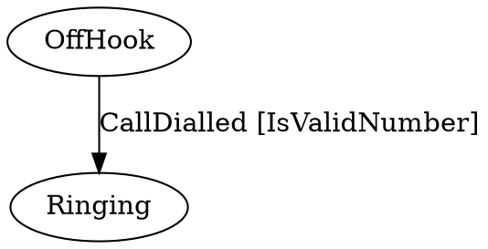
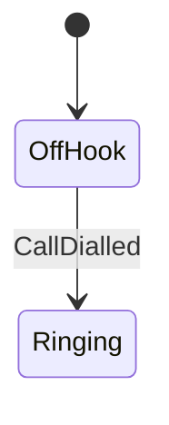

# Stateless [](https://github.com/dotnet-state-machine/stateless/actions/workflows/BuildAndTestOnPullRequests.yml) [](https://www.nuget.org/packages/stateless) [](https://gitter.im/dotnet-state-machine/stateless?utm_source=badge&utm_medium=badge&utm_campaign=pr-badge&utm_content=badge) [](http://stackoverflow.com/questions/tagged/stateless-state-machine)

英文版请参阅 [README.md](README.md)。

**直接在 .NET 代码中创建*状态机*以及轻量级的*基于状态机的工作流*：**

```csharp
var phoneCall = new StateMachine<State, Trigger>(State.OffHook);

phoneCall.Configure(State.OffHook)
    .Permit(Trigger.CallDialled, State.Ringing);

phoneCall.Configure(State.Connected)
    .OnEntry(t => StartCallTimer())
    .OnExit(t => StopCallTimer())
    .InternalTransition(Trigger.MuteMicrophone, t => OnMute())
    .InternalTransition(Trigger.UnmuteMicrophone, t => OnUnmute())
    .InternalTransition<int>(_setVolumeTrigger, (volume, t) => OnSetVolume(volume))
    .Permit(Trigger.LeftMessage, State.OffHook)
    .Permit(Trigger.PlacedOnHold, State.OnHold);

// ...

phoneCall.Fire(Trigger.CallDialled);
Assert.AreEqual(State.Ringing, phoneCall.State);
```

本项目以及上面的示例，灵感来自 [Simple State Machine (Archived)](https://web.archive.org/web/20170814020207/http://simplestatemachine.codeplex.com/)。

## 功能

大多数标准状态机构造均受支持：

 * 对任意 .NET 类型（数字、字符串、枚举等）的状态和触发器提供泛型支持
 * 层次状态
 * 状态的进入/退出动作
 * 用于支持条件转换的守卫子句
 * 自省

还提供了一些有用的扩展：

 * 能够在外部存储状态（例如，存储在由 ORM 跟踪的属性中）
 * 参数化触发器
 * 可重入状态
 * 导出为 DOT 图
 * 导出为 mermaid 图

### 层次状态


在下面的示例中，`OnHold` 状态是 `Connected` 状态的子状态。这意味着处于 `OnHold` 的通话仍然保持连接。

```csharp
phoneCall.Configure(State.OnHold)
    .SubstateOf(State.Connected)
    .Permit(Trigger.TakenOffHold, State.Connected)
    .Permit(Trigger.PhoneHurledAgainstWall, State.PhoneDestroyed);
```

除了会报告精确当前状态的 `StateMachine.State` 属性之外，还提供了 `IsInState(State)` 方法。`IsInState(State)` 会把子状态考虑在内，因此如果上面的示例处于 `OnHold` 状态，`IsInState(State.Connected)` 也会求值为 `true`。

### 进入/退出动作

在该示例中，当通话接通时会执行 `StartCallTimer()` 方法。当通话结束时（无论是挂断，还是把电话摔到墙上）会执行 `StopCallTimer()`。

通话可以在 `Connected` 与 `OnHold` 状态之间移动，而不会反复调用 `StartCallTimer()` 和 `StopCallTimer()` 方法，因为 `OnHold` 状态是 `Connected` 状态的子状态。

进入/退出动作的处理程序可以接收一个类型为 `Transition` 的参数，该参数描述触发器、源状态和目标状态。

### 内部转换

有时需要处理某个触发器，但状态不应改变。这就是内部转换。请使用 `InternalTransition`。

### 初始状态转换

可以将子状态标记为初始状态。当状态机进入超状态时，也会自动进入该子状态。可以这样配置：

```csharp
    sm.Configure(State.B)
        .InitialTransition(State.C);

    sm.Configure(State.C)
        .SubstateOf(State.B);
```

由于 Stateless 的内部结构，它并不知道自己何时被“启动”。这使得无法以传统方式处理初始转换。可以通过添加一个虚拟初始状态，然后使用 Activate() 来“启动”状态机，从而绕过这一限制。

```csharp
    sm.Configure(InitialState)
        .OnActivate(() => sm.Fire(LetsGo))
        .Permit(LetsGo, StateA)
```


### 外部状态存储

Stateless 旨在嵌入各种应用程序模型。例如，某些 ORM 对映射数据可以存放的位置有要求，而 UI 框架通常要求将状态存储在特殊的“可绑定”属性中。为此，`StateMachine` 构造函数可以接受用于读取和写入状态值的函数参数：

```csharp
var stateMachine = new StateMachine<State, Trigger>(
    () => myState.Value,
    s => myState.Value = s);
```

在此示例中，状态机将使用 `myState` 对象来存储状态。

另一个示例可以在 example 文件夹中的 JsonExample 解决方案里找到。


### 激活 / 停用

在存储对象状态之前，以及在恢复对象状态时，可能需要执行一些代码。对此请使用 `Deactivate` 和 `Activate`。激活应仅在正常操作开始之前调用一次，并在状态存储之前调用一次。

### 自省

状态机可以通过 `StateMachine.PermittedTriggers` 属性，提供在当前状态下能够成功触发的触发器列表。使用 `StateMachine.GetInfo()` 检索有关状态配置的信息。

### 守卫子句

状态机会根据守卫子句在多个转换之间进行选择，例如：

```csharp
phoneCall.Configure(State.OffHook)
    .PermitIf(Trigger.CallDialled, State.Ringing, () => IsValidNumber)
    .PermitIf(Trigger.CallDialled, State.Beeping, () => !IsValidNumber);
```

```csharp
phoneCall.Configure(State.OffHook)
    .PermitIfAsync(Trigger.CallDialled, State.Ringing, async () => await IsValidNumber())
    .PermitIfAsync(Trigger.CallDialled, State.Beeping, async () => !await IsValidNumber());
```

同一状态内的守卫子句必须互斥（多个守卫子句不能同时有效）。子状态可以通过重新指定来覆盖转换，但子状态不能禁止超状态所允许的转换。

每当触发器被触发时，都会对守卫子句求值。因此守卫应当没有副作用。

### 参数化触发器

可以为触发器分配强类型参数：

```csharp
var assignTrigger = stateMachine.SetTriggerParameters<string>(Trigger.Assign);

stateMachine.Configure(State.Assigned)
    .OnEntryFrom(assignTrigger, email => OnAssigned(email));

stateMachine.Fire(assignTrigger, "joe@example.com");
```

可以使用 `PermitDynamic()` 配置方法，借助触发器参数动态选择目标状态。

### 被忽略的转换与可重入状态

在 Stateless 中，触发一个没有与之关联的允许转换的触发器会导致抛出异常。这确保所有转换都被显式定义，从而防止意外的状态更改。

要在某些状态中忽略触发器，请使用 `Ignore(TTrigger)` 指令：

```csharp
phoneCall.Configure(State.Connected)
    .Ignore(Trigger.CallDialled);
```

或者，可以将状态标记为可重入。可重入状态是能够转换回自身的状态。在这种情况下，会执行该状态的退出动作和进入动作，从而提供一种处理需要该状态重置或重新初始化的事件的方式。

```csharp
stateMachine.Configure(State.Assigned)
    .PermitReentry(Trigger.Assigned)
    .OnEntry(() => SendEmailToAssignee());
```

状态也可以具有条件可重入，包括同步和异步。

```csharp
stateMachine.Configure(State.Assigned)
    .PermitReentryIf(Trigger.Assigned, () => ShouldSendEmailAgain())
    .OnEntry(() => SendEmailToAssignee());
```

```csharp
stateMachine.Configure(State.Assigned)
    .PermitReentryIfAsync(Trigger.Assigned, async () => await ShouldSendEmailAgain())
    .OnEntry(() => SendEmailToAssignee());
```

默认情况下，必须显式忽略触发器。要覆盖 Stateless 在触发未处理的触发器时抛出异常的默认行为，请使用 `OnUnhandledTrigger` 方法配置状态机：

```csharp
stateMachine.OnUnhandledTrigger((state, trigger) => { });
```

### 动态状态转换与状态重入

动态状态转换允许在运行时根据触发器参数或其他逻辑确定目标状态。

```csharp
stateMachine.Configure(State.Start)
    .PermitDynamic(Trigger.CheckScore, () => score < 10 ? State.LowScore : State.HighScore);
```

当动态转换的结果与当前状态相同时，它实际上会变成一次可重入转换，从而导致该状态的退出动作和进入动作被执行。这对于需要根据某些触发器刷新或重置状态的场景可能很有用。

```csharp
stateMachine.Configure(State.Waiting)
    .OnEntry(() => Console.WriteLine($"Elapsed time: {elapsed} seconds..."))
    .PermitDynamic(Trigger.CheckStatus, () => ready ? State.Done : State.Waiting);
```

### 状态变更通知（事件）

Stateless 支持 2 种状态机事件：
 * 状态转换
 * 状态机转换完成

#### 状态转换
```csharp
// Synchronously
stateMachine.OnTransitioned((transition) => { });

// Asynchronously
stateMachine.OnTransitionedAsync((transition) => { return Task.FromResult(0); });
```
每次状态机改变状态时都会调用此事件。

#### 状态机转换完成
```csharp
// Synchronously
stateMachine.OnTransitionCompleted((transition) => { });

// Asynchronously
stateMachine.OnTransitionCompletedAsync((transition) => { return Task.FromResult(0); });
```
此事件将在触发器处理的最末尾、最后一个进入动作执行完毕之后被调用。

---

除此之外，Stateless 还让你可以按 3 种方式取消对状态机事件的注册。
 * 状态转换取消注册（同步/异步）
 * 状态机转换完成（同步/异步）
 * 状态机全部取消注册（同步和异步）


#### 状态机转换取消注册（同步）
```csharp
// Keep a reference to the synchronous callback action we want to unregister later.
Action transitionCallbackAction = (transition) => { };
stateMachine.OnTransitionedUnregister(transitionCallbackAction);
```
此方法会从转换事件中取消注册指定的动作回调。

#### 状态机转换取消注册（异步）
```csharp
// Keep a reference to the asynchronous callback function we want to unregister later.
Func<Transition, Task> transitionAsyncCallback = (transition) => { return Task.FromResult(0); };
stateMachine.OnTransitionedAsyncUnregister(transitionAsyncCallback);
```
此方法会从转换事件中取消注册指定的异步函数回调。

#### 状态机转换完成取消注册（同步）
```csharp
// Keep a reference to the synchronous callback action we want to unregister later.
Action<Transition> transitionCompletedCallbackAction = (transition) => { };
stateMachine.OnTransitionCompletedUnregister(transitionCompletedCallbackAction);
```
此方法会从转换完成事件中取消注册指定的动作回调。

#### 状态机转换完成取消注册（异步）
```csharp
// Keep a reference to to the asynchronous callback function we want to unregister later.
Func<Transition, Task> transitionCompletedAsyncCallback = (transition) => { return Task.FromResult(0); };
stateMachine.OnTransitionCompletedAsyncUnregister(transitionCompletedAsyncCallback);
```
此方法会从转换完成事件中取消注册指定的异步函数回调。

#### 取消注册所有已注册的回调（同步和异步）
```csharp
stateMachine.UnregisterAllCallbacks();
```
此方法会从状态机中取消注册所有以同步方式和异步方式注册的回调。

### 导出为 DOT 图

在运行时可视化状态机可能会很有用。采用这种方式时，代码是权威来源，状态图则是始终保持最新的副产物。
 
```csharp
phoneCall.Configure(State.OffHook)
    .PermitIf(Trigger.CallDialled, State.Ringing, IsValidNumber);
    
string graph = UmlDotGraph.Format(phoneCall.GetInfo());
```

`UmlDotGraph.Format()` 方法返回状态机在 [DOT graph language](https://en.wikipedia.org/wiki/DOT_(graph_description_language)) 中的字符串表示，例如：



随后可以由支持 DOT 图语言的工具进行渲染，例如来自 [graphviz.org](http://www.graphviz.org) 的 [dot command line tool](http://www.graphviz.org/doc/info/command.html)，或 [viz.js](https://github.com/mdaines/viz.js)。若想立即看到效果，请参见 <http://www.webgraphviz.com>。
命令行示例：`dot -T pdf -o phoneCall.pdf phoneCall.dot`，用于生成 PDF 文件。

### 导出为 Mermaid 图

也可以从状态机生成 Mermaid 图。
 
```csharp
phoneCall.Configure(State.OffHook)
    .PermitIf(Trigger.CallDialled, State.Ringing);
    
string graph = MermaidGraph.Format(phoneCall.GetInfo());
```

`MermaidGraph.Format()` 方法返回状态机的 [Mermaid](https://docs.github.com/en/get-started/writing-on-github/working-with-advanced-formatting/creating-diagrams#creating-mermaid-diagrams) 字符串表示，例如：

```
stateDiagram-v2
     [*] --> OffHook
    OffHook --> Ringing : CallDialled
```

这可以由 GitHub markdown 或 [Obsidian](https://github.com/obsidianmd) 之类的引擎渲染。



### 异步触发器

在提供 `Task<T>` 的平台上，`StateMachine` 支持 `async` 进入/退出动作等：

```csharp
stateMachine.Configure(State.Assigned)
    .OnEntryAsync(async () => await SendEmailToAssignee());
```

在这些情况下，必须使用 `*Async()` 方法注册异步处理程序。

要触发会调用异步动作的触发器，必须使用 `FireAsync()` 方法：

```csharp
await stateMachine.FireAsync(Trigger.Assigned);
```

**注意：** 虽然 `StateMachine` 可以_异步_使用，但它仍然是单线程的，不可被多个线程_并发_使用。

## 高级功能 ##

### 保留 SynchronizationContext ###
在所有处理程序方法都必须在使用方的 `SynchronizationContext` 上被调用的特定情况下，请在创建时设置 `RetainSynchronizationContext` 属性：

```csharp
var stateMachine = new StateMachine<State, Trigger>(initialState)
{
    RetainSynchronizationContext = true
};
```

例如，在 Microsoft Orleans Grain 中设置此项至关重要，因为 Grain 需要 `SynchronizationContext` 才能调用其他 Grain。

## 构建

Stateless 通过面向 .NET Framework 4.6.2、.NET Standard 2.0 以及 .NET 8.0、9.0 和 10.0，可在 .NET 运行时版本 4+ 以及几乎所有现代 .NET 平台上运行。构建该解决方案需要 Visual Studio 2017 或更高版本。


## 贡献

我们欢迎对本项目的贡献。更多信息请查看 [CONTRIBUTING.md](CONTRIBUTING.md)。


## 项目目标

本页几乎完整地描述了 Stateless，其明确目标是保持精简。

如果您希望报告问题或讨论功能，请使用 issue tracker 或 Discussions 页面。

（_为什么取这个名字？Stateless 实现的是关于状态转换的那一组规则，但至少在使用构造函数的委托版本时，它本身并不维护任何内部状态。_）
